# Gearbox C assembly guide

This guide builds the full-size, hand-cranked model of gearbox version C in 13 steps. That takes about 1 to 2 hours once the parts are printed.
In every picture the parts you add in that step are **orange** and the parts already in place are grey.

## Before you start

Check you have every part. Each card shows how many you need.

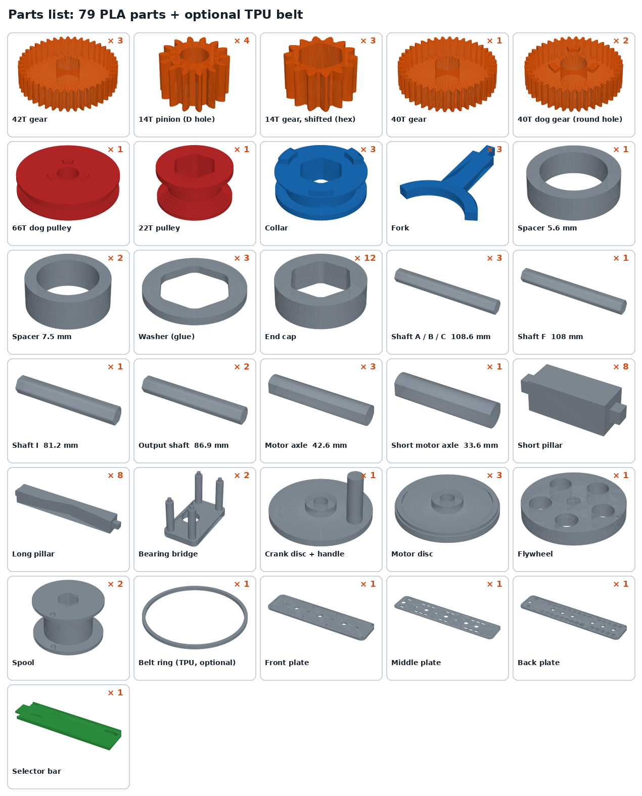

You also need:

- Superglue (CA) for the parts marked "glue".
- A 3 mm cord loop, a rubber band or the printed TPU ring for the flywheel belt.
- About 1 m of string for the two climber spools.
- A ruler or calipers, and a pen to mark the selector positions.

No screws are needed. The square pillar pegs push into the round plate holes; add a drop of glue if one is loose.

Three parts look alike, so sort them first:

| Part | How to tell it apart |
| --- | --- |
| 14T pinion (4) | Round hole with one flat side (D hole). Goes on the motor axles. |
| 14T shifted gear (3) | Hex hole, slightly taller teeth. Goes on shafts B, C and I. |
| 40T dog gear (2) vs 40T gear (1) | The dog gear has a round hole and 3 lugs on one face. The plain 40T has a hex hole. |

## Step 1: Glue the gears onto the shafts

Glue only the orange parts now. Each number is the distance from the **front end of the shaft** to the **front face of the gear**. Leave the blue parts loose: they must slide or spin.

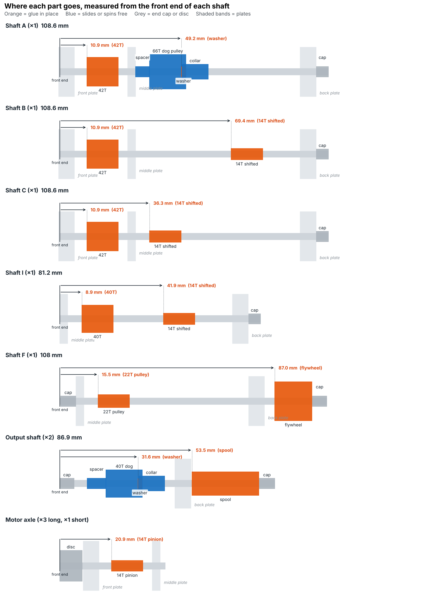

1. Slide each gear on, measure with a ruler or calipers, and set it square to the shaft.
2. Put one drop of superglue where the gear meets the shaft. Keep glue out of the teeth.
3. Do **not** glue the flywheel or the spools yet; they go on after the back plate in step 11.
4. Let everything dry for 10 minutes before moving on.

Shafts A, B and C are identical before gluing, so label them with a pen as you go. Glue the pinions onto the motor axles at 20.9 mm, with the flat of the axle lined up with the flat in the pinion's hole.

## Step 2: Front plate and short pillars

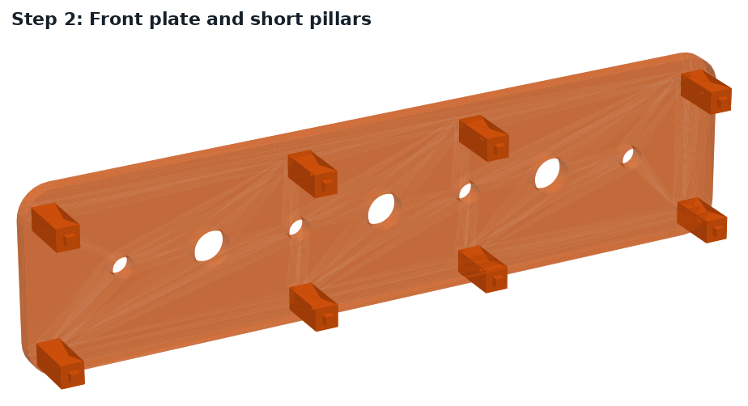

- The front plate is the one with 3 large and 4 small holes in a row. The motors (crank discs) will sit on its outside.
- Push the 8 short pillars into the small holes near the top and bottom edges. The **longer peg** goes into the front plate.
- Find the flywheel end now: lay the middle plate over the front plate. The middle plate sticks out about 30 mm further at one end. That is the flywheel end.

## Step 3: Shafts A, B, C and the motor axles

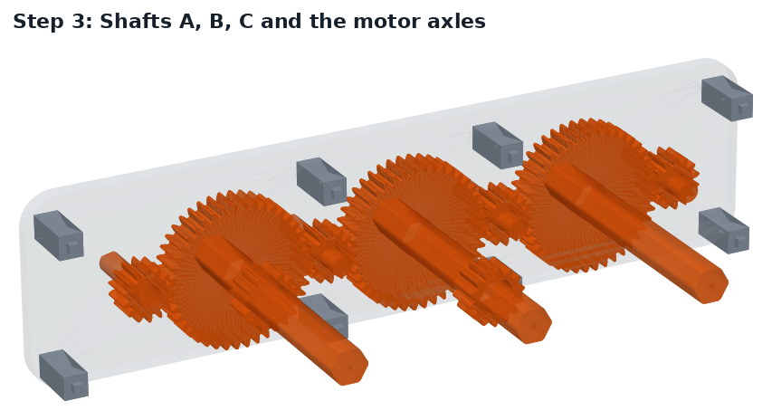

- From the inside, push shafts A, B and C into the 3 large holes, gears facing in. The shaft ends should sit flush with the outside of the plate, not stick out.
- Push the motor axles into the 4 small holes from the inside, pinions facing in. The flat end pokes out the front for the crank disc.
- The **short axle** goes in the end hole furthest from the flywheel end.
- Turn the shafts until every pinion meshes with the 42T gears on both sides of it. Turn one pinion: all 7 gears in the row should turn together.

## Step 4: Middle plate

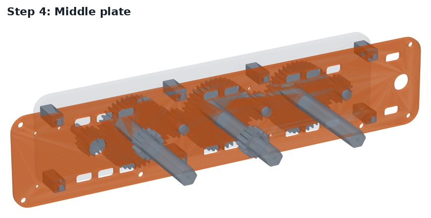

- Lower the middle plate onto the pillar pegs, with its long end at the flywheel end.
- Thread shafts A, B, C through its large holes and the 3 long motor axles through its small holes. The short axle stops just in front of it.
- Press down until it sits on all 8 pillars. Check the gear row still turns freely.

## Step 5: Long pillars and bearing bridges

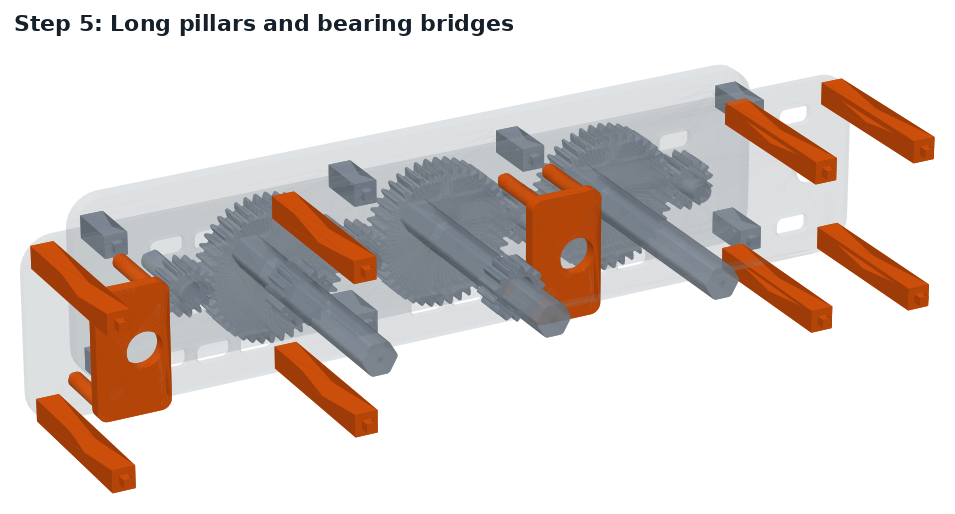

- Push the 8 long pillars into the back face of the middle plate. The **shorter peg** goes into the middle plate.
- Push the 2 bearing bridges into the two groups of 4 small holes. Their legs only fit one way round, with the flat plate facing back.

## Step 6: Shaft A gets the spacer, dog pulley, washer and collar

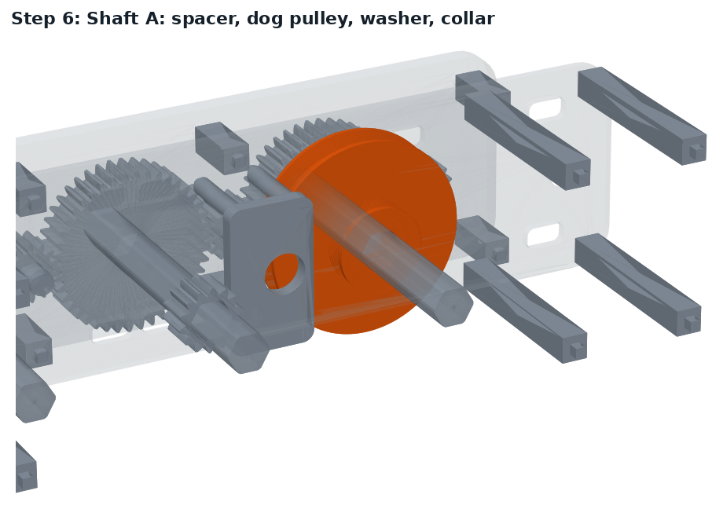

- Slide onto shaft A, behind the middle plate, in this order: the 5.6 mm spacer, the 66T dog pulley, a washer, then a collar.
- **Glue the washer** right behind the pulley: push the pulley forward against the spacer, put a sheet of paper between pulley and washer, press the washer against it, add a drop of glue on the shaft side, and pull the paper out once it's set. The washer stops the pulley drifting back into the collar; the paper leaves just enough play for it to spin.
- The pulley's 3 lugs face **back**, toward the collar. The collar's lugs face **forward**, toward the pulley.
- The pulley must spin freely on the shaft; the collar must slide but turn with the shaft.

## Step 7: Shaft I, shaft F and the belt

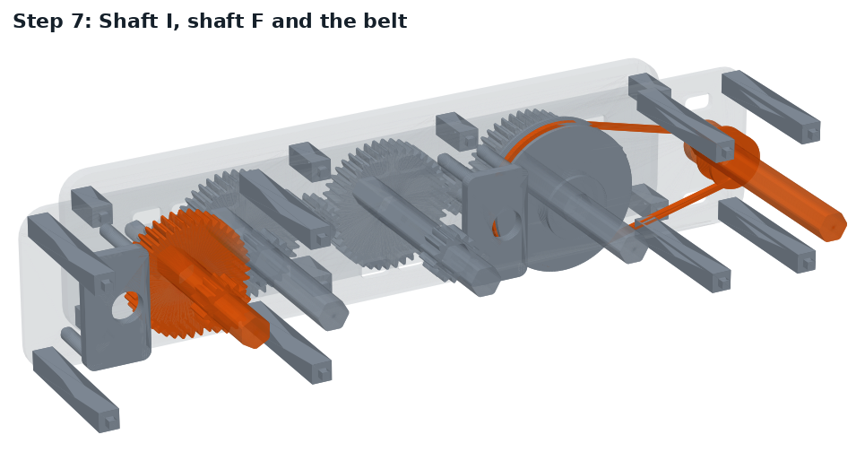

- Push shaft I into the middle plate's large hole at the far end (behind the short axle), front end flush with the plate. Its 40T gear must mesh with the 14T gear on shaft C.
- Push shaft F into the hole at the flywheel end of the middle plate. Put an end cap on its front end, in front of the plate.
- Loop the belt over the small 22T pulley on F and the big 66T pulley on A.

## Step 8: Output shafts

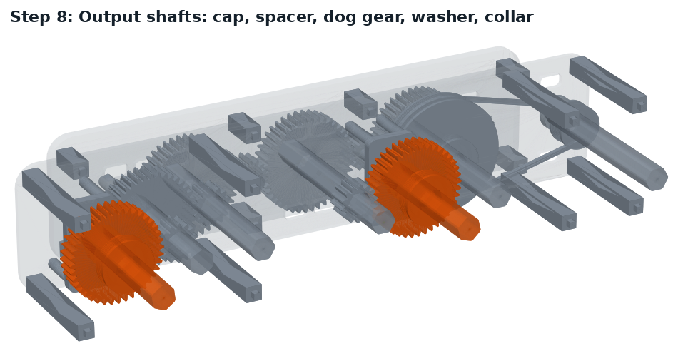

Do this twice: Output 2 uses the bridge next to shaft B, Output 3 the bridge at the far end.

1. From the back, push an output shaft through the bridge until about 6 mm sticks out in front of it.
2. Put an end cap on that front end.
3. From the back end, slide on the 7.5 mm spacer, a 40T dog gear (lugs facing **back**), a washer, then a collar (lugs facing **forward**).
   Glue the washer right behind the dog gear with the paper trick from step 6, so the gear spins but can't drift into the collar.
4. Check the dog gear meshes: Output 2's with the 14T on shaft B, Output 3's with the 14T on shaft I.

## Step 9: Forks on the collars

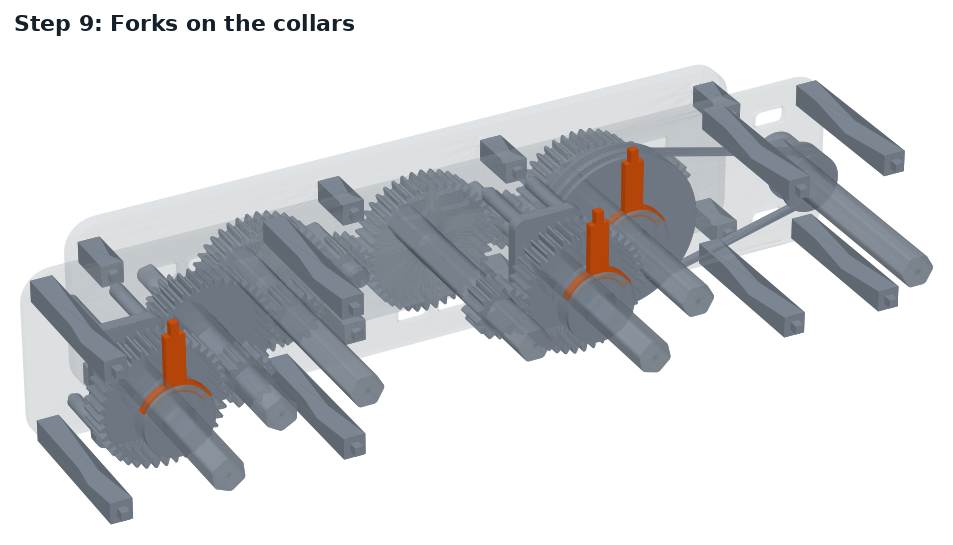

- Clip a fork into the groove of each of the 3 collars from above. The arm points straight up and the small square peg sits on top.
- The collar's lugs pass around the outside of the washer, so the washer never blocks a shift.
- Line all 3 pegs up so they stick up just above the plate edges. The selector bar catches them in step 13.

## Step 10: Back plate

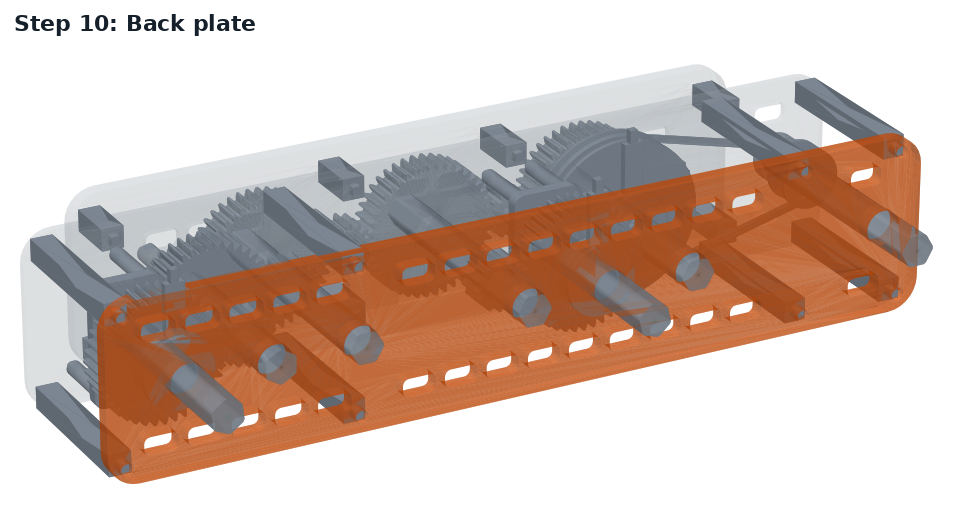

- Lower the back plate onto the long pillars, long end at the flywheel end. The **longer peg** of each pillar goes into the back plate.
- Thread all 7 shafts through it as it goes down: F, A, Output 2, B, C, I, Output 3. Wiggle the cranks slightly if a shaft won't find its hole.
- Press until it sits on all 8 pillars, then turn a pinion: the gear row should still turn freely.

## Step 11: Flywheel, spools and end caps

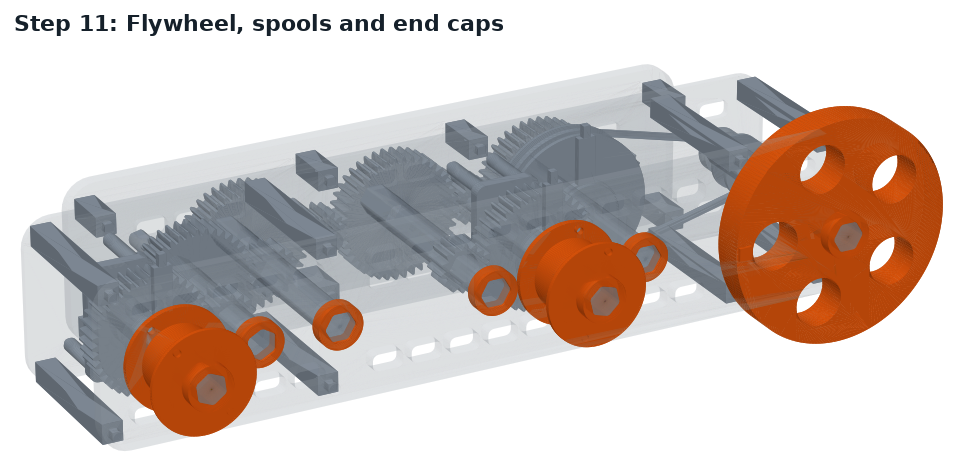

- Glue the flywheel onto shaft F at 87.0 mm from F's front end (about 4 mm behind the back plate).
- Glue a spool onto each output shaft at 53.5 mm from its front end, just clear of the back plate. Tie a string through the small holes in each spool's flange.
- Push end caps onto the back ends of shafts A, B, C, I, F and both outputs. Leave a hair of gap so nothing rubs.

## Step 12: Crank discs

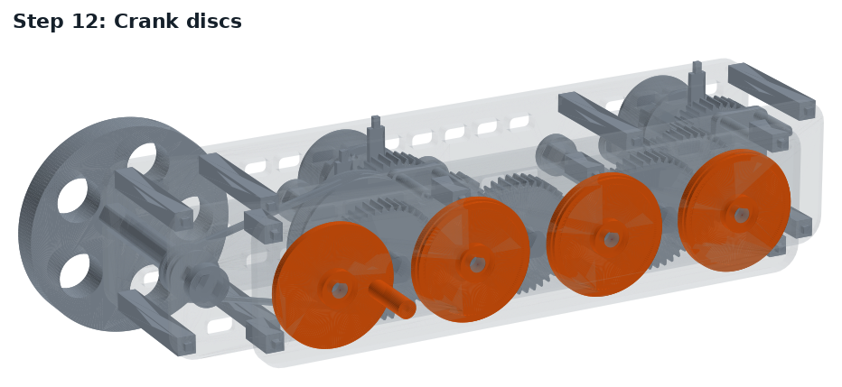

- Turn the model round to the front. Press a disc onto each motor axle, flat to flat, with the hub facing out.
- The disc with the **handle** goes on the motor next to the flywheel.
- Glue them once you are happy everything turns.

## Step 13: Selector bar

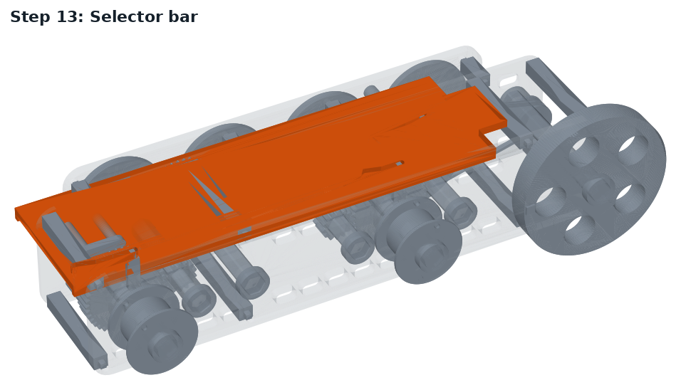

- Set the bar on top of the middle and back plates, handle tab at the flywheel end.
- Its front lip hangs in front of the middle plate and its back lip behind the back plate. These lips keep it on track.
- Each fork peg must drop into its angled slot. Lift the bar slightly and line the pegs up if it doesn't sit flat.
- Slide it end to end once. All three collars should move as it passes their slots.

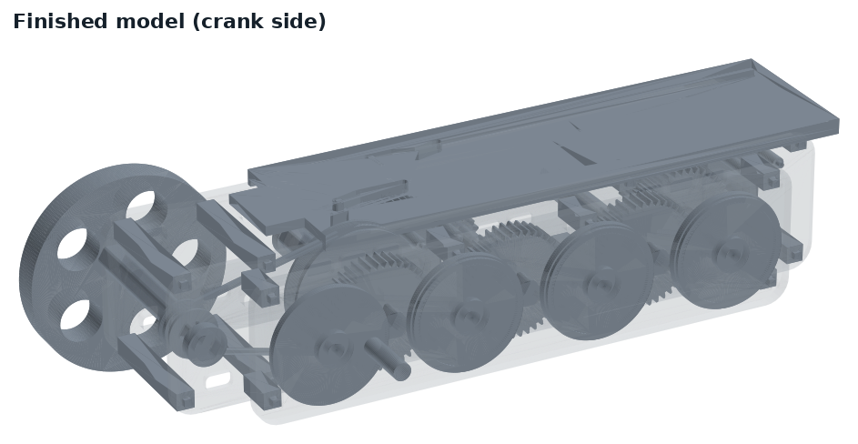

## Using it

The bar has four positions, 11.4 mm apart. Mark them on the plate edge with a pen. Then turn the crank and watch which output moves.

| Bar position | Output | Turns per crank turn |
| --- | --- | --- |
| Pushed fully toward the far end | Output 1, flywheel | 1 (same speed as the motor) |
| One step toward the flywheel | Neutral | Nothing moves at the outputs |
| Two steps | Output 2, climber fast | 1 spool turn every 8.6 crank turns |
| Pulled fully toward the flywheel | Output 3, climber strong | 1 spool turn every 24.5 crank turns |

Shift like the robot would:

1. Stop cranking.
2. Slide the bar to the next position.
3. If it won't go in, the dog lugs are tooth-on-tooth. Rock the crank a few degrees and it drops in.
4. Crank again.

In every position the gear row, shaft I and both 40T dog gears keep turning. Only the collar decides whether a dog gear drives its output shaft.

## If something sticks

| Problem | Fix |
| --- | --- |
| Gear row is stiff | A pinion is pushed too far into a 42T. Loosen the front pillars slightly, or sand the high tooth. |
| Collar won't slide | Sand the shaft flats lightly where the collar travels. |
| Fixed gear slips on its shaft | Add another drop of glue at the hex. |
| Dog pulley or dog gear won't spin | Sand the round hole a little; it must spin freely over the hex corners. |
| Bar slides too easily | Stretch a rubber band across the bar and plate as a light brake. |
| Belt slips | Use a tighter loop or a thicker rubber band. |
