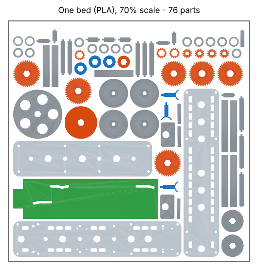

# Version C printable model: one-plate version (70% scale)

The same hand-cranked model as the 1:1 version, scaled to **70%** so all 76 PLA parts fit on **one 350 × 350 mm bed** (Creality K2 Plus). 70% is the largest size that still fits on one bed.

**Fits are not scaled.** The model is built at 1:1 with every clearance divided by 0.7, then scaled down, so each slip fit, sliding fit and peg hole has the same real clearance (in mm) as the full-size model. The scaled parts passed the same collision check at all 4 selector positions.

## Files

| File | What it is |
| --- | --- |
| `bed_one_plate_PLA_70pct.3mf` | All 76 PLA parts, oriented and placed on one bed |
| `bed_TPU_belt_70pct.3mf` | Optional TPU belt ring (a rubber band or 2 mm cord loop works too) |
| `stl/` | Every part on its own, already at 70% |
| `guide/` | Parts sheet and gluing diagram with the 70% measurements |
| `source/` | Scripts that made it. Set `GB_SCALE` to build another size |

About 0.25 kg of PLA, roughly a third of the full-size model's 0.8 kg.

## Slicer settings (K2 Plus, PLA, 0.4 mm nozzle)

- Layer height **0.12 mm**: the gear teeth are smaller now (module 0.89 mm instead of 1.27 mm).
- Walls 3, top/bottom 5 layers, infill 25–30%.
- Supports off.
- 3 mm brim, so the three long plates and the selector bar stay flat. It is a full bed, so let the first layer go slowly.

## Assembly

Follow the [full-size assembly guide](../ASSEMBLY.md). The steps and pictures are the same; use these measurements instead of the full-size ones:

| What | Full size | 70% |
| --- | --- | --- |
| Shafts A, B, C | 108.6 mm | 76.0 mm |
| Shaft F | 108.0 mm | 75.6 mm |
| Shaft I | 81.2 mm | 56.8 mm |
| Output shafts | 86.9 mm | 60.8 mm |
| Motor axles (long / short) | 42.6 / 33.6 mm | 29.8 / 23.5 mm |
| 42T gear on A, B, C | 10.9 mm | 7.7 mm |
| Shifted 14T on B / on C | 69.4 / 36.3 mm | 48.5 / 25.4 mm |
| 40T and 14T on I | 8.9 / 41.9 mm | 6.2 / 29.3 mm |
| 22T pulley on F | 15.5 mm | 10.8 mm |
| Flywheel on F | 87.0 mm | 60.9 mm |
| Spool on each output | 53.5 mm | 37.5 mm |
| Pinion on each motor axle | 20.9 mm | 14.7 mm |
| Spacers (A / outputs) | 5.6 / 7.5 mm | 3.9 / 5.2 mm |
| Selector bar step | 11.4 mm | 8.0 mm |

All distances are measured from the front end of the shaft to the front face of the part. The [gluing diagram](guide/step_01_gluing.png) shows them on each shaft.

Small parts to handle with care at this size:

- The pillar pegs are 2.5 mm square and the bridge pins are 2.1 mm across. Push them in straight.
- The dog lugs are 1.4 mm tall. If a collar slips out under load, add a rubber band so it keeps pressing toward its gear.
